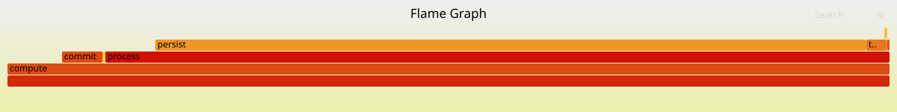
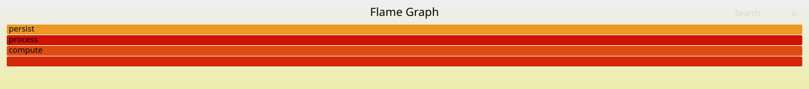
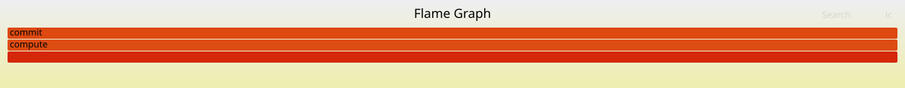

# Profiling Example

Measures instruction costs, heap growth and stable memory growth, and renders
them as flamegraphs.

## How it works

Ask for a profiling build in `build.zig`:

```zig
_ = cdk.addCanister(b, dep, "compute", .{ .profiling = true });
```

This builds `compute.wasm` as usual and `compute_profiling.wasm` next to it.
Setting `pub const cdk_profiling = true;` in the root source file does the
same for a single build.

A profiling build traces every entry point and exports:

| Endpoint                 | Type   | Description                                |
|--------------------------|--------|--------------------------------------------|
| `__get_instructions`     | query  | Current instruction counter                |
| `__get_profiling`        | query  | Paginated trace data                       |
| `__get_profiling_names`  | query  | Function ID to name mapping                |
| `__set_profiling`        | update | Tracing and last-call-only, set explicitly |
| `__toggle_tracing`       | update | Flip trace recording                       |
| `__toggle_entry`         | update | Flip clearing the trace on each call       |
| `__profile_<query>`      | update | Each query again, as an update             |

A query's trace is rolled back with the rest of its state, so each query is
also exported as an update that keeps it.

Each trace entry records three metrics:

- **Instructions**, from `performance_counter`
- **Heap bytes**, live allocations of the CDK allocator
- **Stable pages**, from `stable64_size`

The replica charges 5,000 instructions the first time a message reads an
OS page of heap or stable memory, and 5,000 more the first time it writes
one. These charges land in whichever frame touches the page first, often
the entry point. The profiler pays for its own pages before the entry
point's frame opens.

## Sections

```zig
fn append(item: Item) !void {
    const s = cdk.profiling.section("tree.append");
    defer s.end();
    try validate(item);
    // ...
}
```

`defer` ends the section on every path out, an early `try` return included.
`enter` and `exit` remain for inline spans.

## Measuring from a test

```zig
const profiler = pocket.profiler(cid);

// One call, one trace.
var trace = try profiler.profile(allocator, "compute", {}, .instructions);
defer trace.deinit();

const total = trace.inclusive("process"); // callees included
const own = trace.exclusive("process"); // callees excluded

// A query, through its __profile_ twin.
var q = try profiler.profileQuery(allocator, "get_counter", {}, .instructions);
defer q.deinit();
```

For several calls, `start(.{})`, make the calls, then
`trace(allocator, metric)`. `.last_call_only = true` keeps only the latest.
`stop()` turns tracing off.
`pocket.canister(Codec, cid).profiler()` encodes arguments with `Codec`.

`trace.unbalanced` counts frames closed by an enclosing exit rather than their
own.

## Flamegraphs

```zig
try trace.writeFoldedStacks(io, "profile.folded");
```

```
flamegraph.pl profile.folded > profile.svg
```

## Running the example

```
zig build test        # run tests and produce .folded files
zig build flamegraph  # run tests + render all SVGs
```

## Example output

Instructions:



Stable memory:



Heap memory:


